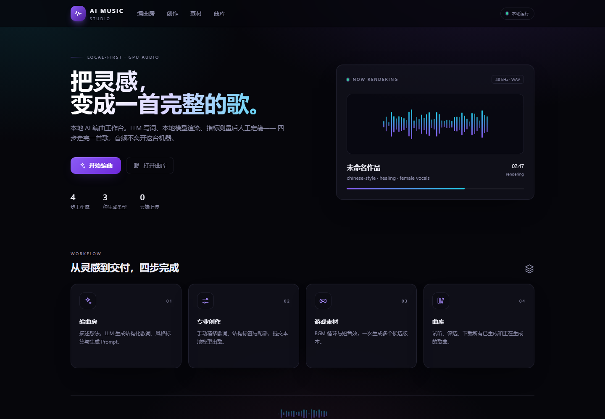
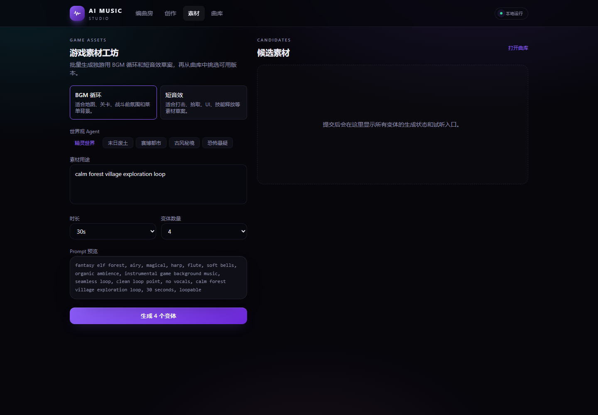

# AI Music Studio

**A local-first pipeline for producing complete songs on your own GPU** — an LLM
writes the lyrics, a local music model renders the audio, every take is measured
before it is believed, and what survives is packaged into a dated delivery folder.

No cloud upload of your music. No account. The only external call is the optional
LLM step that writes lyrics.

<p align="center">
  
  
  
  
  
  
  
</p>

---

## Contents

- [The pipeline](#the-pipeline)
- [Studio preview](#studio-preview)
- [Repository layout](#repository-layout)
- [The measured toolkit](#the-measured-toolkit)
- [What the measurements found](#what-the-measurements-found)
- [Hardware reality and known limits](#hardware-reality-and-known-limits)
  - [8 GB laptop GPUs: the vocal-noise problem](#8-gb-laptop-gpus-the-vocal-noise-problem)
- [Project status](#project-status)
- [Roadmap](#roadmap)
- [Getting started](#getting-started-with-the-studio-prototype)
- [FAQ](#faq)
- [Contributing](#contributing)
- [Acknowledgements](#acknowledgements)
- [License](#license)

## The pipeline

```
   idea / brief
        │
        ▼
  ┌───────────────┐   lyrics + section tags + style caption
  │ LLM write     │   section-quota prompts, repetition audit,
  │ (optional)    │   line-by-line translation sidecar
  └───────┬───────┘
          ▼
  ┌───────────────┐   symbolic plan ──► audio
  │ local model   │   (one process per title, resume-safe,
  │ render        │    multi-candidate with different seeds)
  └───────┬───────┘
          ▼
  ┌───────────────┐   arc · diction · dynamics · clicks · dropouts
  │ measure       │   → candidate ranking + hard gates
  └───────┬───────┘
          ▼
  ┌───────────────┐   WAV + same-stem lyrics TXT + manifest
  │ package       │   + a listening sheet a human can actually use
  └───────────────┘
          ▼
      human ears decide
```

The interesting part of this project is not the generation — it is the
**measurement**. Music models sound plausible in a spectrogram and wrong in your
ears, so every claim here is a number you can re-derive: a dynamic arc measured in
dB, a sung-word rate measured with word-level timestamps, a pitch curve, a
candidate ranking that a person can audit. Prompt text cannot control a
song's dynamic range — that was tried and measured — so the pipeline measures
instead of hoping, and the human stays the final judge.

## Studio preview

The interactive studio is a Next.js front end over the FastAPI queue: arrange
with an LLM, edit the lyric and style, render locally, then listen from the
library. It is deliberately local-only — the UI never talks to a cloud service.

<p align="center">
  
  
</p>

## Repository layout

| Path | What it is |
|---|---|
| `tools/generation/` | Measurement, QA and packaging utilities for a render batch |
| `tools/vocal_repair/` | An earlier experiment in repairing vocal artifacts (deprecated; kept for the record) |
| `services/api/` | FastAPI backend of the earlier "studio" prototype (arrange → queue → render) |
| `apps/web/` | Next.js front end of the same prototype |
| `scripts/` | Model weight download helpers |
| `docs/` | Dev log, workflow notes, and dated design records |

**Audio, model weights and song data are deliberately not in this repository.**
`.gitignore` refuses `outputs/`, `inputs/`, `logs/`, `human_refs/`, `models/`,
`vendor/`, `data/`, `.cache/` and every audio extension. Bring your own.

## The measured toolkit

Everything under `tools/generation/` is a CLI with no hidden state, so results can
be compared between sessions and between takes.

| Tool | Question it answers |
|---|---|
| `arc_qa.py` | Is there a real dynamic arc? Opening level, total lift in dB, where the climax sits on the timeline, how low the body sits under its own peak, rhythmic onset density. Prints an ASCII envelope so the shape is visible without listening. |
| `diction_qa.py` | Did the model actually sing the words? Transcribes a take with faster-whisper and scores it against the intended lyric: character-level ratio, how many lines came back, how much text is missing, and when the first sung word lands. |
| `audio_qa.py` | Is the file broken? Sample-level clicks, dropout gaps, and a zero-crossing-based harsh-frame count — a diagnostic table, explicitly **not** an acceptance gate. |
| `loudness.py` | Linear loudness normalisation that does not touch the spectrum. |
| `export_delivery.py` | Builds the dated delivery folder: one WAV per take, a same-stem lyrics file (section tags once, each translated line under its source line), and a `manifest.json` carrying every take's own numbers. |
| `battle_review.py` | Renders the listening sheet: the metrics with an explanation of how to read them, plus a short checklist. |
| `services/api/app/services/lyric_diversity.py` | Rejects mechanically repeated lyrics — a hook is allowed to return, a wall of identical lines is not. |

Typical use:

```bash
# how does this take move?
python -I tools/generation/arc_qa.py outputs/mybatch/selected/01_song.wav

# did it sing the words?
python -I tools/generation/diction_qa.py --lyrics inputs/01_song_lyrics.txt \
    --language en --out logs/diction.md outputs/mybatch/selected/01_song.wav

# package a finished batch
python -I tools/generation/export_delivery.py \
    --batch-dir outputs/mybatch --engine Local --name mybatch
```

`diction_qa.py` expects a faster-whisper model on disk (`--model`, default
`PR_AIMusic_Extension/models/faster-whisper-small`); download one with
`faster-whisper`'s own tooling and point `--model` at it. Everything else needs
only `numpy` and `soundfile`.

## What the measurements found

The measurements are not decoration. They settle arguments that listening alone
cannot, and they make engine choice reproducible. One example: the same 12
battle briefs (same lyrics, same tags, same acceptance rules) were rendered by
two local engines and scored with the same tooling.

| Metric (one same-brief comparison) | YuE2-3B | HeartMuLa 3B |
|---|---:|---:|
| Length chosen by the model | 184.5 s | 120 s |
| Opening suppression below peak | −20.4 dB | −11.3 dB |
| Total dynamic lift | **+20.4 dB** | +11.3 dB |
| Bridge dip before the final climax | **−26.0 dB** | −17.3 dB |
| Share of the track that is quiet | **0.28** | 0.12 |
| Diction coverage (1.0 ≈ whole lyric returned) | 1.10 | 1.03 |

Across all 12 shared briefs, YuE2 averaged a 13.7 dB lift and a −23.4 dB bridge
dip; HeartMuLa averaged 9.8 dB and −20.6 dB. Diction differed in opposite
directions — HeartMuLa was slightly ahead per character, YuE2 returned slightly
more of the text. On the "欲扬先抑" brief — quiet opening, late climax — the
measurement agreed with the listener, which is the only reason the ranking is
allowed to decide anything.

Two other results shaped the project:

- **Prompt text cannot set dynamic range.** Asking for "quiet verse, huge
  chorus" in the caption moved the measured lift by less than the seed-to-seed
  variance. Structure had to be controlled with a symbolic plan and measured,
  not requested in prose.
- **A long post-processing chain trades one artifact for another.** Frame
  repair, EQ shelves, de-essing and formant shaping each improved a proxy while
  moving the audible defect somewhere else. Source-clean generation plus
  candidate selection beat every repair chain that was tried.

## Hardware reality and known limits

Notes worth having before you spend a night on this:

- **A 12 GB card is the practical floor** for a full-length song with a
  high-fidelity codec. Peak memory is driven by the decode stage, not by song
  length, so a 3-minute song and a 6-minute song can peak the same.
- **The KV cache, not the song, decides whether you can render.** If the model
  preallocates for its maximum sequence length, right-sizing it to prompt+frames
  frees gigabytes and is usually the difference between "fits" and "OOM".
- **One process per title.** A long-lived process fragments the CUDA allocator
  across generations and eventually fails during a large single allocation.
  Paying one model load per title removes that failure mode entirely.
- **`expandable_segments` is not available on Windows.** Process hygiene is the
  workaround, not configuration.
- **Close anything else that holds VRAM** (a resident image-generation UI will
  happily sit on 10 GB and starve a render).
- **A resident model owns RAM, not just VRAM.** Free physical memory collapsed to
  under 2 GB in one measured session; a render that normally takes 6.5 minutes
  took 29 because of it. The audio was unaffected — token generation is
  determined by step count, not wall time.
- Sample-level click counts are **useless as a defect metric in percussion-heavy
  music**: drums are transients by definition. Measured across one delivery, the
  click rate varied 100× between titles and none of it was a defect.

### 8 GB laptop GPUs: the vocal-noise problem

Measured on an **RTX 4060 Laptop (8 GB)**. If you render vocals on a card this
size, you will hear artifacts that do not appear in a clean 12 GB run. This is
not a broken install, and it is not fixed by a better prompt. It is a
memory-driven quality ceiling — and it was measured frame by frame.

**What it sounds like**

- a thin, "electronic" or airless vocal timbre, especially on sustained notes
- hiss and buzz around 4–10 kHz, worst on nasal or emphasized syllables
- short dropouts or "breaks" at phrase boundaries (single frames drop 10–13×)
- crackle or smearing on fast transients and at high notes
- a noise floor that stays audible between phrases instead of decaying

**Why it happens**

1. **Guidance is disabled to fit 8 GB.** Classifier-free guidance doubles the
   batch, so an 8 GB card is forced onto `cfg_scale=1.0`, which turns guidance
   off. On the same seed and loudness on a 12 GB card, `cfg=1.0` produced 854
   clicks and 6 dropouts per 30 s; `cfg=2.0` produced 469 and 1. The low-VRAM
   path is not just a slower route to the same audio — it is measurably dirtier.
2. **The KV cache is sized for the maximum sequence, not your song.** The
   backbone preallocates for `max_seq_len=8192` regardless of length. On 8 GB
   that pressure is what forces the low-guidance path; right-sizing the cache to
   prompt + frames frees about 2.4 GB and is often the difference between
   "fits" and OOM.
3. **The codec frame rate is 12.5 Hz — one frame per 80 ms.** Fast transients
   (consonants, attacks, phrase ends) are quantized to that grid. The residual
   crackle and smearing live here. No EQ removes them, because the information
   was never in the latent.
4. **The codec reconstructs high frequencies badly.** Against a human vocal
   reference, the generated stem carried +4.9 dB at 8–12 kHz and +6.0 dB at
   12–16 kHz, with 148 artifact events over 88 s (16% of the track),
   concentrated on nasal and stressed notes. The vocal noise floor measured
   −46 to −62 dB; a human reference sits below −70 dB.
5. **Long takes do not fit.** A 60 s take on 8 GB crashed inside the codec
   (access violation) after token generation had already succeeded; the working
   path is split generation with overlap and crossfade, which adds seams. On
   YuE2, the NAR prefill OOMs unless the query chunk is halved, and the CUDA
   allocator fragments across titles, so one process per title is mandatory.

**What was tried, and why it did not fix it**

Frame repair, de-buzz EQ, de-essing, high-note taming, noise-floor reduction and
WORLD-based transition repair were all built and measured. They can lower a
proxy score, but listeners consistently heard the trade: the hiss moved, the
consonants got duller, or the joins got worse. The project pivoted to
**source-clean generation plus candidate selection** for exactly this reason.
Those tools remain in `tools/vocal_repair/` as a recorded negative result, not
as the recommended path.

**If 8 GB is all you have**

- Render 30–45 s drafts, not full songs, and use the studio to iterate on lyrics
  and arrangement.
- Keep `cfg=1.0`, right-size the KV cache, and run one title per process.
- Measure before you listen: `audio_qa.py` for clicks/dropouts, `arc_qa.py` for
  the dynamic shape. Treat the numbers as a defect detector, not a quality score.
- Expect a draft, not a deliverable. The 12 GB floor above is the practical line
  for full-length, high-fidelity vocals.

## Acceptance philosophy

Three rules that came out of building this, each of them the hard way:

1. **Measure, then listen — and never let a proxy overrule an ear.**
   Spectral proxies cannot tell a sibilant from machine noise, and a model that
   scores perfectly can still sound synthetic. Numbers rank candidates; a person
   picks the take.
2. **Fix the source, not the symptom.** A long chain of post-processing (frame
   repair, EQ shelves, formant shaping) traded one artifact for another and hit a
   hard ceiling. Source-clean generation plus candidate selection beat it.
3. **When a metric and a listener disagree, the metric is wrong until proven
   otherwise.** Anchor the number to the listener: have them point at the exact
   seconds that sound wrong, measure those frames against the rest of the track,
   find the statistic that separates the two groups, then gate on it. That loop
   is the only way a proxy earns trust.

## Project status

**Alpha.** The measurement toolkit and the studio API/UI are usable; the model
recipes are still moving, so interfaces may change between minor releases.
Tested on Windows 10/11 with an RTX 3060 12 GB (delivery path) and an RTX 4060
Laptop 8 GB (draft path). The public source covers the studio and the
measurement layer; the tuned generation recipes behind our own deliveries are
not included.

## Roadmap

- [x] Measured QA toolkit: arc, diction, audio, loudness, delivery packaging
- [x] Local studio API + queue + library, with restart recovery
- [x] Path-safe audio serving and a documented API contract
- [x] Redesigned local UI with a real generation-type workflow
- [ ] Pluggable generation backends behind a documented adapter protocol
- [ ] Open recipe format (YAML) with example recipes for each backend
- [ ] SSE job progress and a waveform player with seeking
- [ ] Reproducible benchmark harness with a small example corpus
- [ ] LoRA training workflow (code only; datasets stay private)
- [ ] One-command Windows environment check and installer

Priorities are shaped by reproducible issues: a bug report with a log and a
measured failure mode is worth more than a feature request.

## Getting started with the studio prototype

`services/api` + `apps/web` are a front end/back end pair around a local model:
arrange with an LLM → queue → render → library, all on `127.0.0.1`. They are kept
as a working reference for the interactive path; the measured pipeline above is
what this project actually runs for deliveries.

**The API contract is written down in [`docs/api.md`](docs/api.md)** — every
endpoint, its payloads, the `generation_type` mapping, and the failure semantics.
Change one side of the interface by changing that document too.

```bash
cp .env.example .env         # set DEEPSEEK_API_KEY for /arrange; .env is gitignored
pip install -r services/api/requirements-dev.txt   # runtime + test deps

# 1. a model checkout + weights next to the repo (not versioned; ~10 GB)
python scripts/download_models.py
# 2. the model's own API server on 127.0.0.1:8765 (the default ACESTEP_BACKEND=api)
# 3. tests, backend, then front end
cd services/api && python -m pytest -q
cd services/api && python -m uvicorn app.main:app --port 8000
cd apps/web && npm install && npm run dev
```

After installing the API dependencies in the root `.venv` (or
`services/api/.venv`), the ACE-Step checkout and its own `.venv`, and the frontend
dependencies, `start.bat` downloads missing model weights and starts the three
services on Windows. It locates the repository from its own path; set
`AI_MUSIC_ROOT` to use another repository root. Missing prerequisites, occupied
ports, and readiness timeouts stop startup with an error. Existing processes are
never killed automatically. The launcher and `npm run dev` / `npm start` bind
the frontend to `127.0.0.1`.

### Three kinds of generation

`POST /generate` takes a `generation_type`, and the back end turns it into what
the model is actually asked for:

| `generation_type` | what it produces | how the request differs |
|---|---|---|
| `song` | a sung song (or an instrumental, via `instrumental: true`) | nothing added |
| `bgm_loop` | seamlessly looping background music | instrumental, `seamless loop / loopable / clean loop point` |
| `sfx` | a sound effect | non-musical, no vocals, 10 s unless a duration is given |

So one API covers **music and sound effects**; the mapping lives in one place
(`resolve_request()` in `services/api/app/services/acestep_runner.py`) and is
covered by tests, so the UI cannot promise a type the pipeline ignores.

## FAQ

**Does anything leave my machine?**
Only the optional lyric-writing call to the LLM you configure. Audio, model
weights and song data stay local, and the API binds to `127.0.0.1`.

**Why WAV and not MP3?**
WAV is the measured artifact. MP3 duplicates the same audio and makes A/B
comparisons harder; `export_delivery.py --mp3` exists if you need it.

**Can I use this commercially?**
The code is MIT. Model weights are not covered by that license: check each
model's terms. YuE2 is CC BY-NC 4.0 — do not assume commercial rights.

**Why is my 8 GB output noisy?**
See the 8 GB section above. It is a memory-driven guidance/codec ceiling, not a
prompt problem.

**Can I plug in another model?**
The measured toolkit is model-agnostic. The public studio currently wires
ACE-Step's REST API; a documented backend adapter is on the roadmap.

**Is there a cloud version?**
No. This is a local-first project by design.

## Contributing

Small, evidence-backed pull requests are welcome. The full guide — branch model,
commit format, review rules and security notes — is in
[CONTRIBUTING.md](CONTRIBUTING.md).

**The short version:**

- Branch from `main`; never commit directly to `main`.
- Use a typed, short-lived branch: `feat/<slug>`, `fix/<slug>`,
  `docs/<slug>`, `test/<slug>`, `refactor/<slug>`, `chore/<slug>`.
- Keep one topic per branch and one topic per PR. Rebase on `main` before review.
- Commits follow [Conventional Commits](https://www.conventionalcommits.org/):
  `feat(api): add SSE job progress`, `fix(queue): claim jobs atomically`.
- Open the PR against `main`; it is squash-merged after one maintainer review.
  Releases are `v0.x.y` tags — there is no long-lived `develop` branch.
- External contributors: fork, push the branch to your fork, and open the PR.

Before opening a PR:

```bash
cd services/api && python -m pytest -q
cd apps/web && npm run build
```

Reproduce a failure and attach the log and the measured numbers. A change that
alters the API must update `docs/api.md` in the same PR.

## Acknowledgements

This project stands on open models and tools: ACE-Step 1.5, HeartMuLa, YuE2,
faster-whisper, Demucs, PyTorch, FastAPI and Next.js. Model weights are not
distributed here; each carries its own license.

## License

MIT — see `LICENSE`. Model weights carry their own licenses; check the model you
download. Contributions are accepted under the same MIT license.
